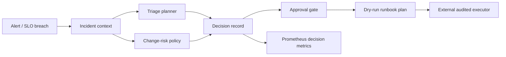

# Reliability Command Center

An evidence-first control plane for safe SRE incident operations. It turns an
alert and bounded observability evidence into a deterministic, hash-addressed
decision record: triage, change-risk assessment, required approval, and a
dry-run-only runbook plan. It deliberately cannot execute cloud, Kubernetes,
shell, or ticketing mutations.

## Architecture



## Safety invariants

- All evidence is bounded, structured and explicitly labelled by source.
- The planner records uncertainty instead of inventing a root cause.
- A stable `decision_id` hashes canonical input, so an external approver can
  bind an approval to exactly one immutable record.
- Only pre-defined, dry-run runbook templates may be proposed.
- A high-risk change requires a valid, scoped approval before a plan is emitted.
- The generated record is audit data—not a record of any real outage or action.

## Quick start

```bash
python3 -m reliability_command_center.cli \
  --incident examples/checkout-incident.json \
  --decision /tmp/decision.json \
  --metrics /tmp/reliability_command_center.prom
```

The fixture is fictional. It makes no claim about a production incident, SLO,
deployment, customer impact or successful remediation.

## Repository map

- `src/`: deterministic orchestration domain logic.
- `policies/`: approval/risk boundary documented as data.
- `grafana/`: dashboard query starter for decision metrics.
- `docs/`: architecture, incident operations and threat model.
- `.github/`: validation and dependency-update automation entry point.

## Extending responsibly

An LLM can summarize the decision record or propose a hypothesis only after
the same schema and guardrails have validated it. Keep model/tool adapters
read-only. A real executor must independently authenticate approvals, bind them
to a single decision hash, expire them, and enforce least privilege.

## Validation

```bash
python3 -m pytest
ruff check src tests
```
